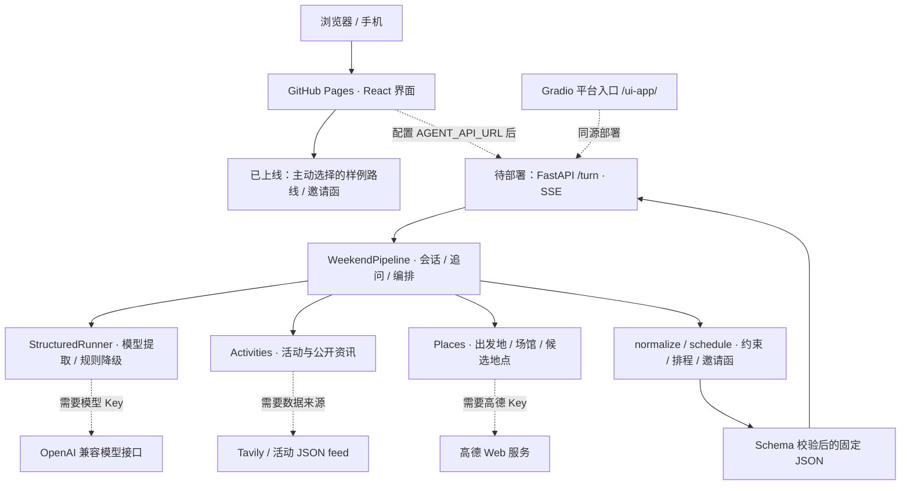

# 架构与代码框架

项目面向同城居民，负责发现活动、整合资讯、排路线和生成邀请函。范围为同一天、1–6 人；不订票、不订位、不支付、不向朋友代发消息。

## 当前部署与完整运行架构



实线表示代码中的调用或当前样例页面；虚线标注需要补齐的云端配置。公网目前只有 Pages 样例体验；图中 Python 后端与外部工具适配已有源码，尚未完成真实服务部署和联调。

## 目录与职责

```text
weekend-local-agent/
├── frontend/                         React + TypeScript + Vite
│   ├── src/App.tsx                   居住地、对话、条件表单、路线、邀请函
│   ├── src/api.ts                    SSE 客户端、超时、明确标注的静态样例
│   ├── src/style.css                 桌面及手机界面
│   ├── public/                       欢迎页素材
│   └── dist/                         同源部署用构建结果
├── space/
│   ├── app.py                        FastAPI HTTP / SSE 与 Gradio 根入口
│   ├── requirements.txt              后端依赖
│   └── Dockerfile                    扁平 ModelScope 包镜像入口
├── agent/
│   ├── weekend_agent/
│   │   ├── server.py                 依赖组装与环境变量读取
│   │   ├── service/pipeline.py       会话、意图、追问、工具调用、结果排序
│   │   ├── domain/
│   │   │   ├── understanding.py      无模型时的受限需求解析
│   │   │   └── planning.py           校验、时间交集、通勤估算、预算、邀请函
│   │   └── adapters/
│   │       ├── runner.py             模型输出解析、Schema 校验、重试与降级
│   │       ├── providers.py          高德地理编码、坐标转换、场馆和周边 POI
│   │       ├── information.py        活动 feed、公开搜索、来源对齐与去重
│   │       └── demo-data.json        明确标注的杭州静态灵感库
│   ├── prompts/                      协调模型提示词与执行边界
│   ├── turn.schema.json              HTTP 输入
│   ├── coordinator.schema.json       模型需求提取结果
│   ├── response.schema.json          固定对外响应
│   ├── plan.schema.json              完整路线
│   ├── event-feed.schema.json        活动供给输入
│   └── .env.example                  配置名称，不含密钥
├── tests/                            48 项后端回归测试
├── scripts/
│   ├── build_space.py                扁平 ModelScope 部署目录
│   ├── package_release.py            源码 ZIP、部署 ZIP、SHA-256
│   ├── verify_public_site.py         公网 HTTP 与样例契约复验
│   └── publish_github.py             源码推送与 Pages 发布配置
├── .github/workflows/
│   ├── ci.yml                        后端测试、前端构建、平台打包
│   └── pages.yml                     Pages 构建与发布
├── docs/                             架构、接口、联网证据、实测截图
├── Dockerfile                        完整同源 Python 云后端镜像
├── render.yaml                       Render 单实例部署定义
├── example-resident-request.json     居民条件输入示例
├── example-response.json             样例输出；不代表实时活动
└── event-feed.template.json           空供给模板；不是现成活动库
```

核心依赖方向：`space → service → domain`，`adapters → domain`。`server.py` 负责把具体适配器注入 `WeekendPipeline`；测试可以注入受控 HTTP 响应，无需消耗付费 API。

## 一轮完整后端规划

1. `space/app.py` 限制请求体、校验 `turn.schema.json`、获取会话锁，开始 SSE。
2. `pipeline.py` 处理用户确认的常住地、明确表单或本轮对话。换城市清除旧起点和路线。
3. `runner.py` 调用协调模型提取意图和槽位。输出不符合 Schema 时重试一次，再使用 `understanding.py` 规则降级。无 Key 时直接规则理解。
4. 缺少信息或时段归属不明确时先追问；正常请求用 `normalize()` 校验日期、人数、预算和共同空闲窗口。
5. `Activities.discover()` 读取活动供给，按城市和日期过滤，并从官方、本地生活、小红书公开索引渠道发现线索。
6. `Places.find()` 查询每个人的日常起点和周边 POI；活动供给的场馆可进入候选，不只是附在最终文案中。
7. `Activities.attach()` 对齐场馆与来源。记录有结构化日期时保留 `provider_record`；普通网页摘要用 `search_result`，不能冒充日期已核实。
8. `schedule()` 计算消费、站间移动和往返预留，剔除超过预算、距离、通勤或时间窗口的组合。排序后返回最多三条。
9. 程序生成邀请函，验证 `plan.schema.json` / `response.schema.json`，SSE 返回最终结果。

当前是一个协调模型加程序工具。`coordinator`、`search`、`planner`、`inviter` 是执行状态标签，不表示四个独立推理模型。界面展示真实工具状态和校验摘要，不输出思维链。

## 状态和错误策略

| 情况 | 当前行为 |
| --- | --- |
| 无模型 Key / 模型失败 | 受限规则理解；复杂条件可用表单 |
| 缺城市、起点、时间、预算或偏好 | 先追问；不猜测城市或住宅 |
| 不同人时段无法归属 | 暂停规划，清除当前可邀请路线，分别补充 |
| 无高德 Key / 地图请求失败 | 保留本地条件，提示配置或重试；不自动给杭州 |
| 活动供给或公开检索失败 | 地图可用时返回地点组合，注明活动未确认 |
| 只有一套可行路线 | 如实返回一套并说明 |
| 无可行路线 | 提示调整预算、时间或距离 |
| 接口总超时 / 结构错误 | SSE 返回可恢复错误；不会将错误伪装成检索成功 |

会话位于单进程内存，闲置 30 分钟后清理，最多 200 个。当前不含生产级账号、共享会话存储或高并发治理。浏览器不持久保存居住地与对话。

## 仍需完善的产品能力

- 活动目前只有日级起止日期，未覆盖营业时段或具体场次；交通按直线距离估算。
- 真实工具模式三套路线可能重复两站，当前主要按首站区分。
- 路线固定三站，共同窗口至少三小时；“只喝咖啡 90 分钟”仍需短路线模板。
- 场馆别名对齐需要加入 POI ID、地址与坐标核对。
- 上述真实工具行为由受控测试覆盖，尚不能说明真实活动源覆盖率或推荐质量。

完整调用格式见 [接口契约](api-contract.md)；上线证据与边界见 [联网验证报告](online-verification.md)。
